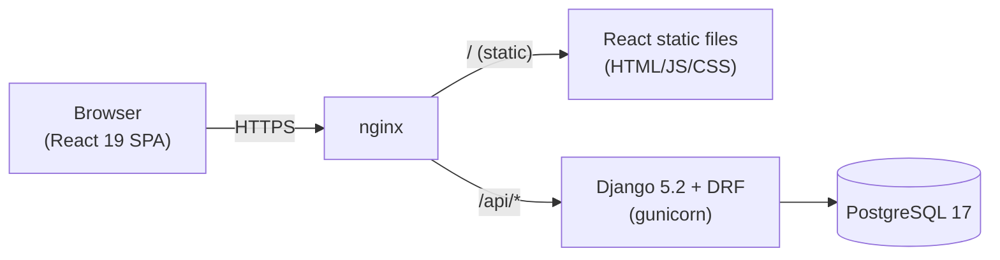

# MeetingSpace — Architecture

## System diagram



- `nginx` is the single public entry point. It serves the built React static
  files directly and reverse-proxies any `/api/*` request to the Django app
  server (gunicorn).
- Django/DRF is the only process that talks to PostgreSQL.
- The React SPA never talks to PostgreSQL directly and holds no database
  credentials.

## Session + CSRF authentication flow

1. The browser loads the SPA from `nginx` (static files, no auth required).
2. Before logging in, the SPA calls `GET /api/auth/csrf/`. Django sets a
   `csrftoken` cookie (readable by JavaScript, not `HttpOnly`) in the
   response.
3. The SPA reads the `csrftoken` cookie value and sends it back in the
   `X-CSRFToken` request header on `POST /api/auth/login/`, along with
   `{username, password}` in the body.
4. Django authenticates the credentials. On success it starts a session and
   sets a `sessionid` cookie that is `HttpOnly`, `SameSite=Lax` (or `Strict`),
   and `Secure` when `DJANGO_SECURE_HTTPS=True`. The response body contains
   the logged-in user's `{id, username, is_staff}`.
5. For every subsequent request, the browser automatically attaches the
   `sessionid` cookie. Django's `AuthenticationMiddleware` resolves it to a
   `User` on `request.user`.
6. For every unsafe request (`POST`/`PATCH`/`PUT`/`DELETE`), the browser must
   also attach the current `X-CSRFToken` header matching the `csrftoken`
   cookie; Django's `CsrfViewMiddleware` rejects the request with `403` if it
   is missing or mismatched. `GET`/`HEAD`/`OPTIONS` are exempt.
7. `POST /api/auth/logout/` destroys the server-side session and clears the
   `sessionid` cookie.
8. Because the session cookie is `HttpOnly`, it is never readable by
   JavaScript, which limits the impact of XSS compared to storing a token in
   `localStorage`.

## Folder structure

```
MeetingSpace/
├── backend/                 # Django + DRF project
│   ├── config/               # settings, urls, wsgi/asgi (Step 2+)
│   ├── rooms/                 # Room app (Step 5+)
│   ├── bookings/               # Booking app (Step 6+)
│   └── manage.py
├── frontend/                 # React + TypeScript + Vite app
│   └── src/
├── docs/                     # SPEC.md, API.md, ARCHITECTURE.md, DECISIONS.md
├── .github/workflows/        # CI/CD pipelines
├── docker-compose.yml        # nginx + backend + frontend build + db (local dev)
├── .env.example
├── .editorconfig
└── README.md
```
